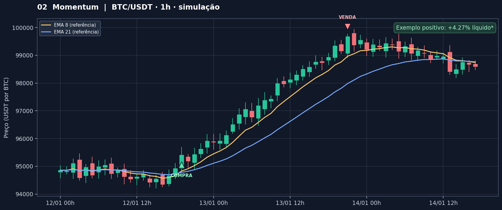
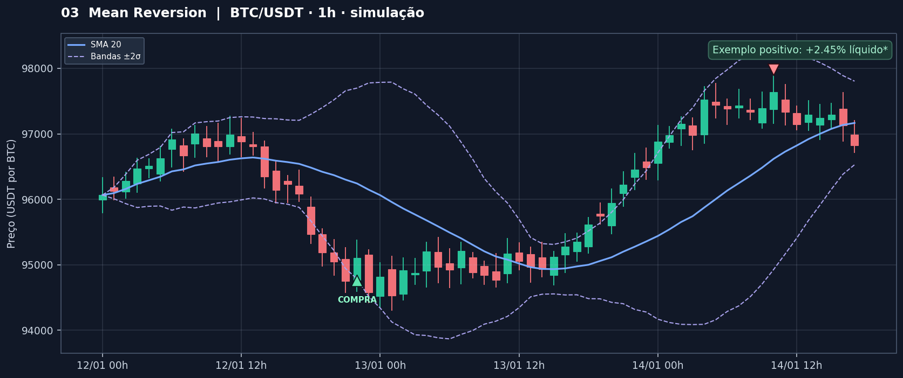
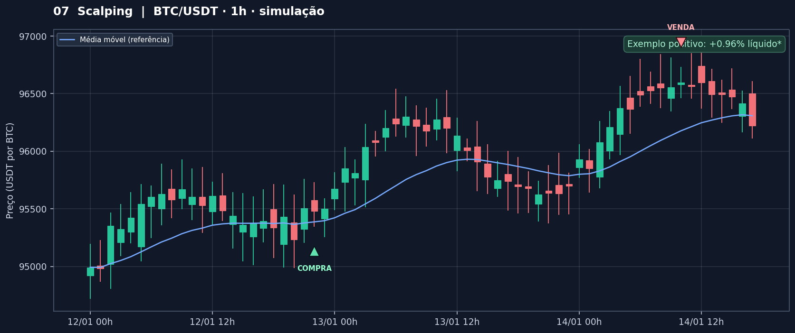
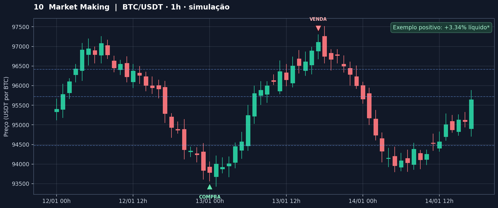
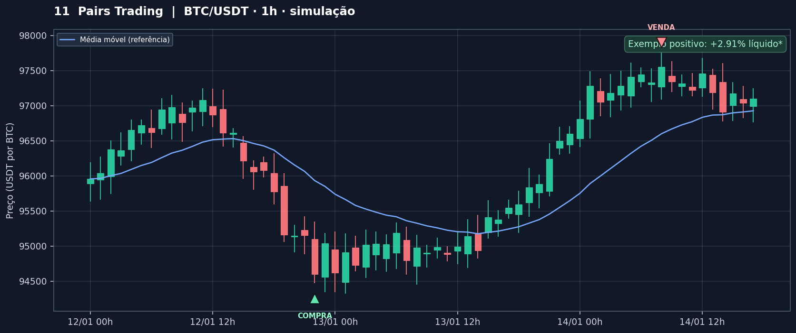
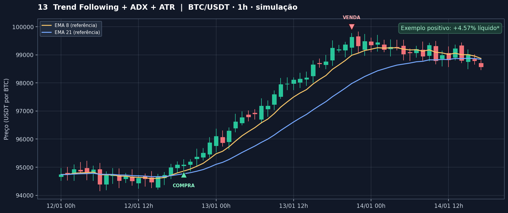
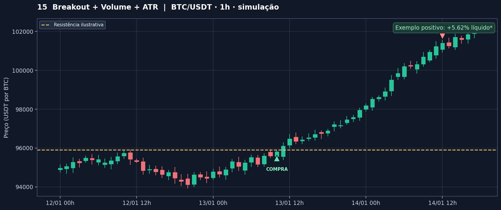
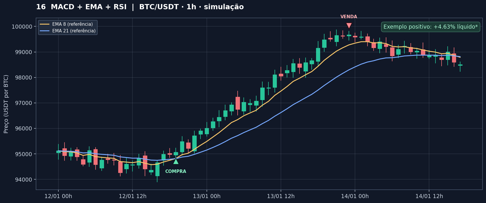

# Tutorial de Estratégias de Trading de Criptomoedas — BTC/USDT

> **Material didático — novembro de 2026.** Todos os preços, candles, volumes, pontos de compra/venda e resultados apresentados são **sintéticos**. As operações foram selecionadas para demonstrar casos positivos e **não** representam backtests históricos, resultados reproduzíveis ou recomendação de investimento.

## Objetivo e como ler este documento

Este guia documenta **12 estratégias individuais** e **6 combinações**, com gráficos PNG de candles BTC/USDT no intervalo de **1 hora**, indicadores visuais, marcadores **COMPRA** e **VENDA**, regras e riscos. Cada gráfico possui um JSON correspondente com OHLCV sintético e sinais para leitura numérica por IA.

> **Para agentes de IA:** o texto Markdown é autossuficiente para interpretar a lógica; a imagem é evidência visual didática; o JSON contém os preços exatos. Uma referência `` não garante, por si só, que o agente tenha aberto a imagem. Para verificar os números, leia `data/<nome>.json`.

## Convenções e fórmula de resultado

- **Candles:** verde = fechamento ≥ abertura; vermelho = fechamento menor que abertura.
- **Marcadores:** triângulo verde com texto `COMPRA`; triângulo vermelho com texto `VENDA`.
- **Par:** BTC/USDT (Bitcoin precificado em Tether); **timeframe:** 1h; **fuso:** UTC.
- **Taxas hipotéticas:** compra 0,10% e venda 0,10%; não inclui spread real, slippage, impostos nem impacto de mercado.
- **Retorno líquido ilustrativo:** `((preco_venda * (1 - 0.001)) / (preco_medio_compra * (1 + 0.001)) - 1) * 100`.
- **Ordens:** os sinais são posições didáticas no gráfico, e não backtests de regras executadas em tempo real. Em produção, os sinais devem ser calculados sem usar candles futuros, respeitando a abertura do próximo candle ou simulação realista de ordens.
- **Limite de escopo:** arbitragem depende de dois livros de ofertas, pairs trading de um segundo ativo, ranking de vários ativos e market making de dados de livro; seus gráficos BTC/USDT não demonstram sozinhos a execução completa.

## Índice

| Nº | Estratégia | Tipo | Gráfico |
|---:|---|---|---|
| 01 | [Trend Following](#01-trend-following) | Individual | [PNG](images/trend-following.png) |
| 02 | [Momentum](#02-momentum) | Individual | [PNG](images/momentum.png) |
| 03 | [Mean Reversion](#03-mean-reversion) | Individual | [PNG](images/mean-reversion.png) |
| 04 | [Grid Trading](#04-grid-trading) | Individual | [PNG](images/grid-trading.png) |
| 05 | [Breakout](#05-breakout) | Individual | [PNG](images/breakout.png) |
| 06 | [Swing Trading](#06-swing-trading) | Individual | [PNG](images/swing-trading.png) |
| 07 | [Scalping](#07-scalping) | Individual | [PNG](images/scalping.png) |
| 08 | [Arbitragem](#08-arbitragem) | Individual | [PNG](images/arbitragem.png) |
| 09 | [DCA — compras periódicas](#09-dca) | Individual | [PNG](images/dca.png) |
| 10 | [Market Making](#10-market-making) | Individual | [PNG](images/market-making.png) |
| 11 | [Pairs Trading](#11-pairs-trading) | Individual | [PNG](images/pairs-trading.png) |
| 12 | [Machine Learning](#12-machine-learning) | Individual | [PNG](images/machine-learning.png) |
| 13 | [Trend Following + ADX + ATR](#13-ema-adx-atr) | Combinação | [PNG](images/ema-adx-atr.png) |
| 14 | [RSI + Bollinger Bands](#14-rsi-bollinger) | Combinação | [PNG](images/rsi-bollinger.png) |
| 15 | [Breakout + Volume + ATR](#15-breakout-volume-atr) | Combinação | [PNG](images/breakout-volume-atr.png) |
| 16 | [MACD + EMA + RSI](#16-macd-ema-rsi) | Combinação | [PNG](images/macd-ema-rsi.png) |
| 17 | [Grid + ADX + ATR](#17-grid-adx-atr) | Combinação | [PNG](images/grid-adx-atr.png) |
| 18 | [Momentum + Ranking de moedas](#18-momentum-ranking) | Combinação | [PNG](images/momentum-ranking.png) |

---

## 01 — Trend Following

**Categoria:** Individual  
**Par:** BTC/USDT · **Intervalo:** 1h · **Natureza:** simulação

**Finalidade:** Acompanhar uma tendência em vez de tentar antecipar fundos.

**Quando utilizar:** Tendência consistente de alta.

**Indicadores:** EMA 8 e EMA 21.

### Regras didáticas de operação

- **Compra:** A EMA(8) cruza acima da EMA(21) com fechamento acima de ambas; entrar no candle seguinte.
- **Venda:** Encerrar ao perder a EMA(21), pelo trailing stop ou em sinal de reversão.
- **Gestão de risco:** delimitar perda máxima por operação, stop técnico e tamanho de posição antes da entrada.

### Gráfico de candles com compra e venda


**Exemplo hipotético:** 1 entrada(s); compra média **95,278.78 USDT**; venda **99,838.75 USDT**; retorno líquido **+4.58%**, considerando exclusivamente taxas hipotéticas de 0,10% em cada lado. *Valores sintéticos, selecionados retrospectivamente.*

**Riscos e limitações:** Em congestão há muitos cruzamentos falsos.

**Dados para leitura por IA:** [`data/trend-following.json`](data/trend-following.json) — contém candles OHLCV, timestamps UTC, entradas, saída, preços e retorno.

---

## 02 — Momentum

**Categoria:** Individual  
**Par:** BTC/USDT · **Intervalo:** 1h · **Natureza:** simulação

**Finalidade:** Buscar continuidade após aumento de força do preço.

**Quando utilizar:** Alta com aceleração e boa liquidez.

**Indicadores:** ROC(5), EMA(10).

### Regras didáticas de operação

- **Compra:** ROC(5) positivo e crescente, EMA(10) ascendente e filtro de volume; comprar após confirmação.
- **Venda:** Sair quando o ROC desacelerar, o preço perder a EMA(10) ou o stop for atingido.
- **Gestão de risco:** delimitar perda máxima por operação, stop técnico e tamanho de posição antes da entrada.

### Gráfico de candles com compra e venda



**Exemplo hipotético:** 1 entrada(s); compra média **95,406.68 USDT**; venda **99,677.26 USDT**; retorno líquido **+4.27%**, considerando exclusivamente taxas hipotéticas de 0,10% em cada lado. *Valores sintéticos, selecionados retrospectivamente.*

**Riscos e limitações:** Compras tardias após movimentos esticados podem sofrer reversão.

**Dados para leitura por IA:** [`data/momentum.json`](data/momentum.json) — contém candles OHLCV, timestamps UTC, entradas, saída, preços e retorno.

---

## 03 — Mean Reversion

**Categoria:** Individual  
**Par:** BTC/USDT · **Intervalo:** 1h · **Natureza:** simulação

**Finalidade:** Comprar após desvio abaixo da média, visando recuperação.

**Quando utilizar:** Mercado lateral com reversões.

**Indicadores:** Bollinger(20,2), SMA(20).

### Regras didáticas de operação

- **Compra:** Candle volta a fechar dentro da banda inferior e o regime não indica tendência forte.
- **Venda:** Realizar próximo à SMA(20) ou à banda superior; stop abaixo do fundo.
- **Gestão de risco:** delimitar perda máxima por operação, stop técnico e tamanho de posição antes da entrada.

### Gráfico de candles com compra e venda



**Exemplo hipotético:** 1 entrada(s); compra média **95,109.00 USDT**; venda **97,635.83 USDT**; retorno líquido **+2.45%**, considerando exclusivamente taxas hipotéticas de 0,10% em cada lado. *Valores sintéticos, selecionados retrospectivamente.*

**Riscos e limitações:** Em tendência forte de baixa, o ativo pode continuar caindo.

**Dados para leitura por IA:** [`data/mean-reversion.json`](data/mean-reversion.json) — contém candles OHLCV, timestamps UTC, entradas, saída, preços e retorno.

---

## 04 — Grid Trading

**Categoria:** Individual  
**Par:** BTC/USDT · **Intervalo:** 1h · **Natureza:** simulação

**Finalidade:** Executar compras e vendas em níveis alternados de uma faixa.

**Quando utilizar:** Consolidação de preço.

**Indicadores:** Faixa de preços, níveis da grade.

### Regras didáticas de operação

- **Compra:** Posicionar ordens limitadas abaixo do preço central da faixa e aguardar execução.
- **Venda:** Vender as quantidades correspondentes nos níveis superiores da grade.
- **Gestão de risco:** delimitar perda máxima por operação, stop técnico e tamanho de posição antes da entrada.

### Gráfico de candles com compra e venda


**Exemplo hipotético:** 1 entrada(s); compra média **93,621.34 USDT**; venda **97,144.91 USDT**; retorno líquido **+3.56%**, considerando exclusivamente taxas hipotéticas de 0,10% em cada lado. *Valores sintéticos, selecionados retrospectivamente.*

**Riscos e limitações:** Queda persistente deixa posição acumulada; taxas e ordens não executadas reduzem o retorno.

**Dados para leitura por IA:** [`data/grid-trading.json`](data/grid-trading.json) — contém candles OHLCV, timestamps UTC, entradas, saída, preços e retorno.

---

## 05 — Breakout

**Categoria:** Individual  
**Par:** BTC/USDT · **Intervalo:** 1h · **Natureza:** simulação

**Finalidade:** Participar de rompimento de resistência com confirmação.

**Quando utilizar:** Compressão seguida de expansão.

**Indicadores:** Resistência, ATR(14).

### Regras didáticas de operação

- **Compra:** Fechamento acima da máxima da janela anterior e filtro de volatilidade.
- **Venda:** Trailing stop por ATR ou perda do nível rompido.
- **Gestão de risco:** delimitar perda máxima por operação, stop técnico e tamanho de posição antes da entrada.

### Gráfico de candles com compra e venda


**Exemplo hipotético:** 1 entrada(s); compra média **95,876.03 USDT**; venda **101,626.77 USDT**; retorno líquido **+5.79%**, considerando exclusivamente taxas hipotéticas de 0,10% em cada lado. *Valores sintéticos, selecionados retrospectivamente.*

**Riscos e limitações:** Rompimentos falsos e slippage em movimentos rápidos.

**Dados para leitura por IA:** [`data/breakout.json`](data/breakout.json) — contém candles OHLCV, timestamps UTC, entradas, saída, preços e retorno.

---

## 06 — Swing Trading

**Categoria:** Individual  
**Par:** BTC/USDT · **Intervalo:** 1h · **Natureza:** simulação

**Finalidade:** Explorar movimento entre suporte e resistência dentro de contexto favorável.

**Quando utilizar:** Oscilações de vários candles ou dias.

**Indicadores:** SMA(20), suportes e resistências.

### Regras didáticas de operação

- **Compra:** Reação confirmada próximo ao suporte, com relação retorno/risco aceitável.
- **Venda:** Saída junto à resistência, por invalidação ou stop.
- **Gestão de risco:** delimitar perda máxima por operação, stop técnico e tamanho de posição antes da entrada.

### Gráfico de candles com compra e venda


**Exemplo hipotético:** 1 entrada(s); compra média **96,735.97 USDT**; venda **97,648.18 USDT**; retorno líquido **+0.74%**, considerando exclusivamente taxas hipotéticas de 0,10% em cada lado. *Valores sintéticos, selecionados retrospectivamente.*

**Riscos e limitações:** Gaps, quedas durante a posição e exposição prolongada.

**Dados para leitura por IA:** [`data/swing-trading.json`](data/swing-trading.json) — contém candles OHLCV, timestamps UTC, entradas, saída, preços e retorno.

---

## 07 — Scalping

**Categoria:** Individual  
**Par:** BTC/USDT · **Intervalo:** 1h · **Natureza:** simulação

**Finalidade:** Explorar pequenos deslocamentos de preço.

**Quando utilizar:** Mercado muito líquido e baixa latência.

**Indicadores:** VWAP, spread e volume.

### Regras didáticas de operação

- **Compra:** Recuperação da VWAP com spread estreito e fluxo favorável.
- **Venda:** Alvo curto, stop rígido e limite de tempo em posição.
- **Gestão de risco:** delimitar perda máxima por operação, stop técnico e tamanho de posição antes da entrada.

### Gráfico de candles com compra e venda



**Exemplo hipotético:** 1 entrada(s); compra média **95,482.41 USDT**; venda **96,594.87 USDT**; retorno líquido **+0.96%**, considerando exclusivamente taxas hipotéticas de 0,10% em cada lado. *Valores sintéticos, selecionados retrospectivamente.*

**Riscos e limitações:** Custos e latência podem superar o ganho; gráfico OHLC não demonstra execuções reais.

**Dados para leitura por IA:** [`data/scalping.json`](data/scalping.json) — contém candles OHLCV, timestamps UTC, entradas, saída, preços e retorno.

---

## 08 — Arbitragem

**Categoria:** Individual  
**Par:** BTC/USDT · **Intervalo:** 1h · **Natureza:** simulação

**Finalidade:** Comprar BTC/USDT em um mercado e vender simultaneamente em outro.

**Quando utilizar:** Diferença líquida positiva entre plataformas.

**Indicadores:** Preço de execução em dois mercados.

### Regras didáticas de operação

- **Compra:** Spread entre ofertas executáveis supera taxas, transferência e riscos.
- **Venda:** Executar pernas de compra e venda praticamente simultâneas.
- **Gestão de risco:** delimitar perda máxima por operação, stop técnico e tamanho de posição antes da entrada.

### Gráfico de candles com compra e venda


**Exemplo hipotético:** 1 entrada(s); compra média **94,914.25 USDT**; venda **95,244.25 USDT**; retorno líquido **+0.15%**, considerando exclusivamente taxas hipotéticas de 0,10% em cada lado. *Valores sintéticos, selecionados retrospectivamente.*

**Riscos e limitações:** Execução de apenas uma ponta, liquidez e transferências; gráfico único é apenas ilustração.

**Dados para leitura por IA:** [`data/arbitragem.json`](data/arbitragem.json) — contém candles OHLCV, timestamps UTC, entradas, saída, preços e retorno.

**Nota específica:** o resultado usa diferença artificial entre Mercado A e Mercado B no mesmo instante. Não interpretar o intervalo entre marcadores como uma operação temporal.

---

## 09 — DCA — compras periódicas

**Categoria:** Individual  
**Par:** BTC/USDT · **Intervalo:** 1h · **Natureza:** simulação

**Finalidade:** Comprar parcelas em datas predefinidas, sem prever fundos.

**Quando utilizar:** Acumulação com horizonte maior.

**Indicadores:** Preço médio ponderado.

### Regras didáticas de operação

- **Compra:** Três compras em momentos predefinidos, com montantes iguais em USDT.
- **Venda:** Venda opcional ao atingir objetivo de portfólio; DCA não exige venda.
- **Gestão de risco:** delimitar perda máxima por operação, stop técnico e tamanho de posição antes da entrada.

### Gráfico de candles com compra e venda


**Exemplo hipotético:** 3 entrada(s); compra média **95,014.66 USDT**; venda **97,997.79 USDT**; retorno líquido **+2.93%**, considerando exclusivamente taxas hipotéticas de 0,10% em cada lado. *Valores sintéticos, selecionados retrospectivamente.*

**Riscos e limitações:** DCA não elimina riscos de queda; escolha retrospectiva da saída favorece o exemplo.

**Dados para leitura por IA:** [`data/dca.json`](data/dca.json) — contém candles OHLCV, timestamps UTC, entradas, saída, preços e retorno.

---

## 10 — Market Making

**Categoria:** Individual  
**Par:** BTC/USDT · **Intervalo:** 1h · **Natureza:** simulação

**Finalidade:** Ofertar compra e venda limitadas tentando capturar spread.

**Quando utilizar:** Livro líquido e spread suficiente.

**Indicadores:** Bid/Ask e spread.

### Regras didáticas de operação

- **Compra:** Ordem passiva de compra no bid, sujeita a fila e execução.
- **Venda:** Ordem passiva de venda no ask após aquisição do inventário.
- **Gestão de risco:** delimitar perda máxima por operação, stop técnico e tamanho de posição antes da entrada.

### Gráfico de candles com compra e venda



**Exemplo hipotético:** 1 entrada(s); compra média **93,785.09 USDT**; venda **97,107.54 USDT**; retorno líquido **+3.34%**, considerando exclusivamente taxas hipotéticas de 0,10% em cada lado. *Valores sintéticos, selecionados retrospectivamente.*

**Riscos e limitações:** Seleção adversa e risco de inventário; candles não representam microestrutura.

**Dados para leitura por IA:** [`data/market-making.json`](data/market-making.json) — contém candles OHLCV, timestamps UTC, entradas, saída, preços e retorno.

---

## 11 — Pairs Trading

**Categoria:** Individual  
**Par:** BTC/USDT · **Intervalo:** 1h · **Natureza:** simulação

**Finalidade:** Negociar a convergência entre dois ativos; visualização focaliza BTC/USDT.

**Quando utilizar:** Relação relativa estável.

**Indicadores:** Z-score da razão BTC/USDT vs ETH/USDT.

### Regras didáticas de operação

- **Compra:** Comprar BTC ao ficar relativamente barato contra ETH segundo z-score validado.
- **Venda:** Vender BTC quando o z-score normalizar; estratégia integral pode exigir a outra ponta.
- **Gestão de risco:** delimitar perda máxima por operação, stop técnico e tamanho de posição antes da entrada.

### Gráfico de candles com compra e venda



**Exemplo hipotético:** 1 entrada(s); compra média **94,600.69 USDT**; venda **97,551.60 USDT**; retorno líquido **+2.91%**, considerando exclusivamente taxas hipotéticas de 0,10% em cada lado. *Valores sintéticos, selecionados retrospectivamente.*

**Riscos e limitações:** Relação estatística pode quebrar; gráfico BTC isolado não prova retorno do par.

**Dados para leitura por IA:** [`data/pairs-trading.json`](data/pairs-trading.json) — contém candles OHLCV, timestamps UTC, entradas, saída, preços e retorno.

**Nota específica:** a posição relativa em ETH/USDT não está simulada no JSON; o resultado é o movimento isolado da perna BTC/USDT, não o P&L de uma carteira long/short.

---

## 12 — Machine Learning

**Categoria:** Individual  
**Par:** BTC/USDT · **Intervalo:** 1h · **Natureza:** simulação

**Finalidade:** Usar previsões probabilísticas para filtrar sinais de compra de BTC/USDT.

**Quando utilizar:** Modelos validados fora da amostra.

**Indicadores:** Probabilidade calibrada e filtros.

### Regras didáticas de operação

- **Compra:** Comprar quando probabilidade prevista ultrapassar limiar calibrado e passar nos filtros.
- **Venda:** Sair quando previsão cair abaixo do limiar ou disparar stop.
- **Gestão de risco:** delimitar perda máxima por operação, stop técnico e tamanho de posição antes da entrada.

### Gráfico de candles com compra e venda


**Exemplo hipotético:** 1 entrada(s); compra média **95,162.78 USDT**; venda **99,572.35 USDT**; retorno líquido **+4.42%**, considerando exclusivamente taxas hipotéticas de 0,10% em cada lado. *Valores sintéticos, selecionados retrospectivamente.*

**Riscos e limitações:** Overfitting, vazamento temporal e mudança de regime; probabilidades no exemplo são didáticas.

**Dados para leitura por IA:** [`data/machine-learning.json`](data/machine-learning.json) — contém candles OHLCV, timestamps UTC, entradas, saída, preços e retorno.

---

## 13 — Trend Following + ADX + ATR

**Categoria:** Combinação  
**Par:** BTC/USDT · **Intervalo:** 1h · **Natureza:** simulação

**Finalidade:** Confirmar direção, força e stop ajustado à volatilidade.

**Quando utilizar:** Alta direcional.

**Indicadores:** EMA 8/21, ADX(14), ATR(14).

### Regras didáticas de operação

- **Compra:** EMA(8)>EMA(21), ADX acima do limiar definido em treino e candle de confirmação.
- **Venda:** Trailing stop de múltiplos do ATR, calculado sem dados futuros.
- **Gestão de risco:** delimitar perda máxima por operação, stop técnico e tamanho de posição antes da entrada.

### Gráfico de candles com compra e venda



**Exemplo hipotético:** 1 entrada(s); compra média **95,087.61 USDT**; venda **99,634.13 USDT**; retorno líquido **+4.57%**, considerando exclusivamente taxas hipotéticas de 0,10% em cada lado. *Valores sintéticos, selecionados retrospectivamente.*

**Riscos e limitações:** Limiar fixo e atraso podem falhar na transição de regimes.

**Dados para leitura por IA:** [`data/ema-adx-atr.json`](data/ema-adx-atr.json) — contém candles OHLCV, timestamps UTC, entradas, saída, preços e retorno.

---

## 14 — RSI + Bollinger Bands

**Categoria:** Combinação  
**Par:** BTC/USDT · **Intervalo:** 1h · **Natureza:** simulação

**Finalidade:** Exigir confirmação de sobrevenda e retorno à banda.

**Quando utilizar:** Lateralização e exaustão de queda.

**Indicadores:** RSI(14), Bollinger(20,2).

### Regras didáticas de operação

- **Compra:** RSI cruza acima do nível de recuperação e preço volta ao interior da banda inferior.
- **Venda:** Alvo na linha média/superior; stop abaixo do fundo recente.
- **Gestão de risco:** delimitar perda máxima por operação, stop técnico e tamanho de posição antes da entrada.

### Gráfico de candles com compra e venda


**Exemplo hipotético:** 1 entrada(s); compra média **94,637.40 USDT**; venda **97,399.20 USDT**; retorno líquido **+2.71%**, considerando exclusivamente taxas hipotéticas de 0,10% em cada lado. *Valores sintéticos, selecionados retrospectivamente.*

**Riscos e limitações:** Sobrevenda não garante reversão.

**Dados para leitura por IA:** [`data/rsi-bollinger.json`](data/rsi-bollinger.json) — contém candles OHLCV, timestamps UTC, entradas, saída, preços e retorno.

---

## 15 — Breakout + Volume + ATR

**Categoria:** Combinação  
**Par:** BTC/USDT · **Intervalo:** 1h · **Natureza:** simulação

**Finalidade:** Filtrar rompimentos sem confirmação de volume.

**Quando utilizar:** Expansão com participação.

**Indicadores:** Resistência, volume relativo, ATR(14).

### Regras didáticas de operação

- **Compra:** Fechamento acima da resistência com volume acima da média da janela anterior.
- **Venda:** Stop móvel em ATR ou perda do patamar rompido.
- **Gestão de risco:** delimitar perda máxima por operação, stop técnico e tamanho de posição antes da entrada.

### Gráfico de candles com compra e venda



**Exemplo hipotético:** 1 entrada(s); compra média **95,817.66 USDT**; venda **101,407.11 USDT**; retorno líquido **+5.62%**, considerando exclusivamente taxas hipotéticas de 0,10% em cada lado. *Valores sintéticos, selecionados retrospectivamente.*

**Riscos e limitações:** Volume pode aumentar em rompimentos falsos.

**Dados para leitura por IA:** [`data/breakout-volume-atr.json`](data/breakout-volume-atr.json) — contém candles OHLCV, timestamps UTC, entradas, saída, preços e retorno.

---

## 16 — MACD + EMA + RSI

**Categoria:** Combinação  
**Par:** BTC/USDT · **Intervalo:** 1h · **Natureza:** simulação

**Finalidade:** Exigir direção de EMA, cruzamento MACD e RSI não excessivo.

**Quando utilizar:** Tendência com retomada de força.

**Indicadores:** MACD(12,26,9), EMA(21), RSI(14).

### Regras didáticas de operação

- **Compra:** Fechamento acima EMA(21), MACD cruza sinal e RSI dentro da faixa definida.
- **Venda:** Vender na perda de força do MACD ou ativação de stop.
- **Gestão de risco:** delimitar perda máxima por operação, stop técnico e tamanho de posição antes da entrada.

### Gráfico de candles com compra e venda



**Exemplo hipotético:** 1 entrada(s); compra média **95,071.69 USDT**; venda **99,672.20 USDT**; retorno líquido **+4.63%**, considerando exclusivamente taxas hipotéticas de 0,10% em cada lado. *Valores sintéticos, selecionados retrospectivamente.*

**Riscos e limitações:** Indicadores derivados do mesmo preço não são confirmações independentes.

**Dados para leitura por IA:** [`data/macd-ema-rsi.json`](data/macd-ema-rsi.json) — contém candles OHLCV, timestamps UTC, entradas, saída, preços e retorno.

---

## 17 — Grid + ADX + ATR

**Categoria:** Combinação  
**Par:** BTC/USDT · **Intervalo:** 1h · **Natureza:** simulação

**Finalidade:** Ativar grade somente se o regime for lateral e dimensionar espaçamento pela volatilidade.

**Quando utilizar:** Lateralização com volatilidade moderada.

**Indicadores:** Níveis grid, ADX(14), ATR(14).

### Regras didáticas de operação

- **Compra:** ADX abaixo do limite validado e compra em nível inferior da grade.
- **Venda:** Venda no nível superior; desligar o grid se ocorrer rompimento.
- **Gestão de risco:** delimitar perda máxima por operação, stop técnico e tamanho de posição antes da entrada.

### Gráfico de candles com compra e venda


**Exemplo hipotético:** 1 entrada(s); compra média **93,880.92 USDT**; venda **96,961.26 USDT**; retorno líquido **+3.07%**, considerando exclusivamente taxas hipotéticas de 0,10% em cada lado. *Valores sintéticos, selecionados retrospectivamente.*

**Riscos e limitações:** ADX atrasado pode manter grade ativada durante início de tendência.

**Dados para leitura por IA:** [`data/grid-adx-atr.json`](data/grid-adx-atr.json) — contém candles OHLCV, timestamps UTC, entradas, saída, preços e retorno.

---

## 18 — Momentum + Ranking de moedas

**Categoria:** Combinação  
**Par:** BTC/USDT · **Intervalo:** 1h · **Natureza:** simulação

**Finalidade:** No universo de moedas, selecionar BTC/USDT apenas quando estiver bem classificado.

**Quando utilizar:** Rotação entre ativos.

**Indicadores:** ROC, liquidez e ranking.

### Regras didáticas de operação

- **Compra:** ROC de BTC supera o limiar e o ranking/volume confirmam sua elegibilidade.
- **Venda:** Vender quando perder a condição de seleção ou bater stop.
- **Gestão de risco:** delimitar perda máxima por operação, stop técnico e tamanho de posição antes da entrada.

### Gráfico de candles com compra e venda


**Exemplo hipotético:** 1 entrada(s); compra média **95,302.66 USDT**; venda **99,514.91 USDT**; retorno líquido **+4.21%**, considerando exclusivamente taxas hipotéticas de 0,10% em cada lado. *Valores sintéticos, selecionados retrospectivamente.*

**Riscos e limitações:** Um único gráfico BTC não demonstra ranking; é preciso consultar os demais pares.

**Dados para leitura por IA:** [`data/momentum-ranking.json`](data/momentum-ranking.json) — contém candles OHLCV, timestamps UTC, entradas, saída, preços e retorno.

**Nota específica:** o ranking entre pares não é calculado com uma única série BTC/USDT; o gráfico demonstra somente a perna BTC.

---

## Como avaliar estratégias sem viés retrospectivo

1. Baixar candles históricos BTC/USDT com timestamps, volume e regras de qualidade de dados.
2. Calcular indicadores apenas com histórico disponível no instante do sinal; operar no candle seguinte ou com simulação de ordens coerente.
3. Incluir taxas reais da conta, spread, slippage, lotes mínimos, arredondamento e ordens parcialmente executadas.
4. Separar treino, validação e teste cronologicamente; usar walk-forward e evitar escolher parâmetros a partir do período de teste.
5. Comparar lucro líquido, drawdown máximo, Sharpe/Sortino, profit factor, expectativa por operação e exposição ao mercado.
6. Comparar contra comprar e manter BTC e também contra permanecer em caixa, com capital inicial equivalente.
7. Validar robustez em vários regimes de mercado e executar paper trading antes de considerar ordens reais.

## Estrutura de arquivos

```text
tutorial_estrategias_cripto_candles/
├── tutorial_estrategias_cripto_candles.md
├── images/                # 18 gráficos PNG BTC/USDT
│   ├── trend-following.png
│   └── ...
└── data/                  # 18 arquivos JSON com candles e sinais
    ├── trend-following.json
    └── ...
```

**Observação:** séries e marcadores são desenhados para exemplificação e não garantem que a execução literal das regras teria gerado as operações indicadas. Particularmente, os indicadores ADX, ATR, RSI, MACD e probabilidades não foram calculados para acionar os marcadores deste material; seus nomes descrevem a metodologia conceitual. Para resultados estatísticos, use um backtest reproduzível com os parâmetros explicitados.
