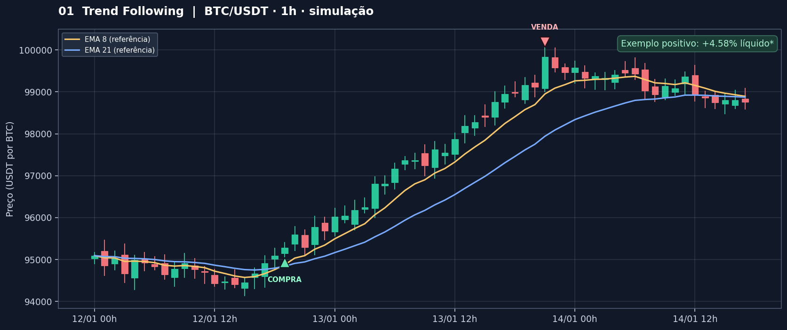
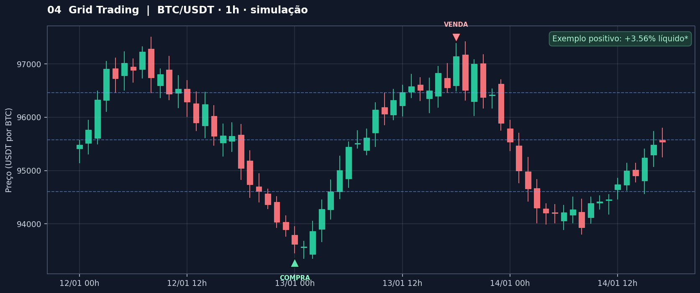
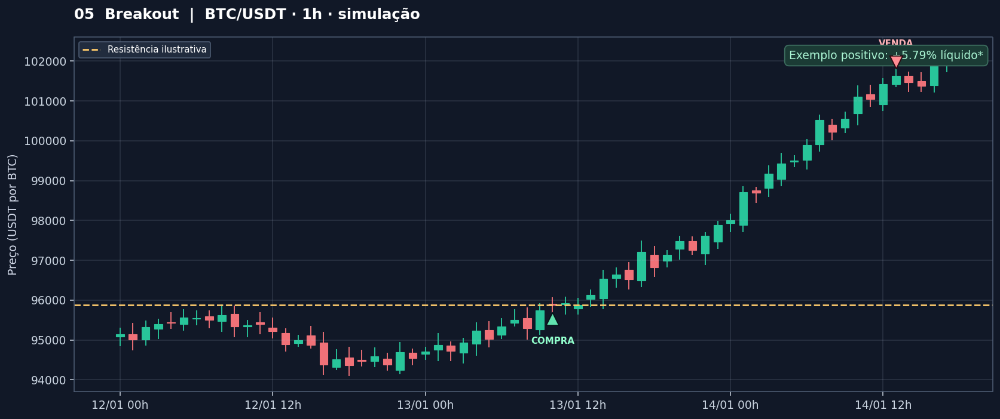
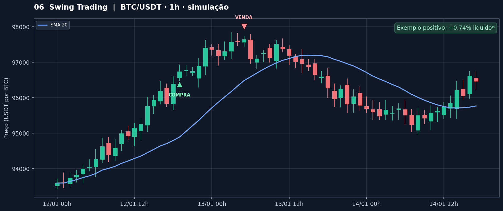
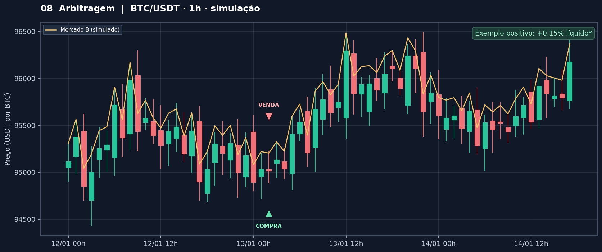
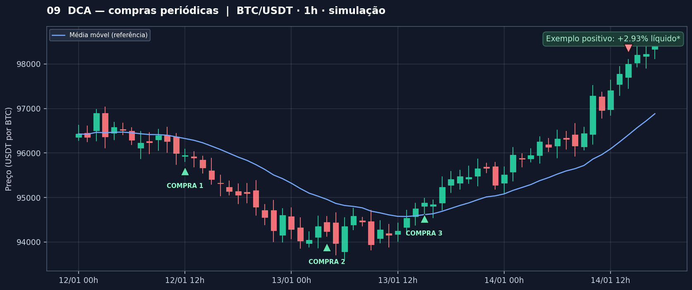
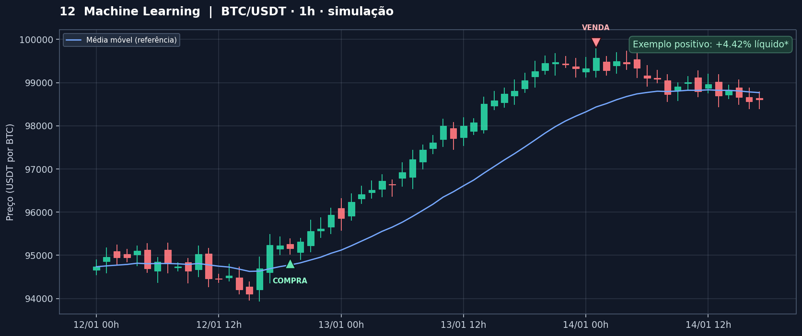
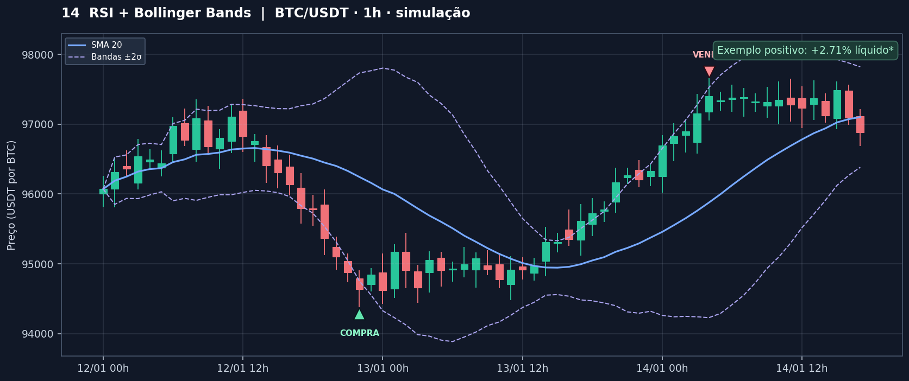
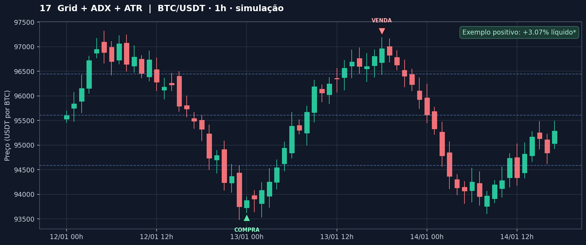
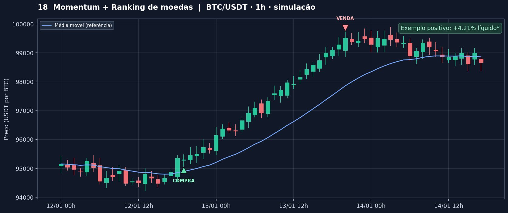

# Tutorial de Estratégias de Trading de Criptomoedas — BTC/USDT

> **Material didático — novembro de 2026.** Todos os preços, candles, volumes, pontos de compra/venda e resultados apresentados são **sintéticos**. As operações foram selecionadas para demonstrar casos positivos e **não** representam backtests históricos, resultados reproduzíveis ou recomendação de investimento.

## Objetivo e como ler este documento

Este guia documenta **12 estratégias individuais** e **6 combinações**, com gráficos PNG de candles BTC/USDT no intervalo de **1 hora**, indicadores visuais, marcadores **COMPRA** e **VENDA**, regras e riscos. Cada gráfico possui um JSON correspondente com OHLCV sintético e sinais para leitura numérica por IA. Também há uma versão dos candles no formato matricial de 12 posições inspirado no endpoint `GET /api/v3/klines` da Binance; os campos auxiliares de volume em USDT, número de trades e compras taker são simulados de forma determinística, com hipóteses descritas no [LEIA-ME](LEIA-ME.md) e nos metadados. Esses valores não representam negócios reais.

> **ATENÇÃO À PROVENIÊNCIA:** o JSON real BTC/USDT de 1 minuto fornecido como referência foi utilizado exclusivamente para identificar o formato; os gráficos atuais são de dados sintéticos em 1 hora. Os valores dos gráficos NÃO são os mesmos do arquivo real.

> **Para agentes de IA:** o texto Markdown é autossuficiente para interpretar a lógica; a imagem é evidência visual didática; o JSON contém os preços exatos. Uma referência `` não garante, por si só, que o agente tenha aberto a imagem. Para verificar os números, leia `data/<nome>.json`.

## Convenções e fórmula de resultado

- **Candles:** verde = fechamento ≥ abertura; vermelho = fechamento menor que abertura.
- **Marcadores:** triângulo verde com texto `COMPRA`; triângulo vermelho com texto `VENDA`.
- **Par:** BTC/USDT (Bitcoin precificado em Tether); **timeframe:** 1h; **fuso:** UTC.
- **Taxas hipotéticas:** compra 0,10% e venda 0,10%; não inclui spread real, slippage, impostos nem impacto de mercado.
- **Retorno líquido ilustrativo:** `((preco_venda * (1 - 0.001)) / (preco_medio_compra * (1 + 0.001)) - 1) * 100`.
- **Ordens:** os sinais são posições didáticas no gráfico, e não backtests de regras executadas em tempo real. Em produção, os sinais devem ser calculados sem usar candles futuros, respeitando a abertura do próximo candle ou simulação realista de ordens.
- **Limite de escopo:** arbitragem depende de dois livros de ofertas, pairs trading de um segundo ativo, ranking de vários ativos e market making de dados de livro; seus gráficos BTC/USDT não demonstram sozinhos a execução completa.

## Como preencher os dados no candlelab-web

As entradas abaixo correspondem ao catálogo implementado na versão **0.2.0**, conferido no código local em **16/11/2026**. São os padrões do simulador, sem otimização a partir dos gráficos. O catálogo retornado por `GET /api/v1/strategies` é a fonte dos campos, limites e padrões efetivos da versão em execução; a tela **Novo processamento** é montada a partir dele. As tabelas de cada estratégia informam o nome técnico da entrada, para facilitar a identificação mesmo quando o formulário exibir um rótulo em inglês.

### Dados compartilhados pela sessão

| Onde informar | Entrada | Como preencher |
|---|---|---|
| Aquisição/importação de candles | Série OHLCV, par e intervalo | Para os exemplos deste tutorial, BTCUSDT e 1h. Na importação, usar `data/<nome>-binance-klines.json`; os JSONs de sinais/metadados não são o dataset de candles. |
| Nova sessão | Nome e conjunto de candles | Selecionar o dataset correspondente ao período que será analisado. |
| Nova sessão | Caixa inicial (USDT) | Valor positivo; o formulário inicia em 1000 USDT. Cada processamento recomeça com esse caixa, sem consumir o resultado de outro. |
| Nova sessão | Taxa por preenchimento (%) | O formulário inicia em 0,1%. Na API, `fee_rate` é uma fração decimal: `"0.001"` corresponde a 0,1%. |
| Novo processamento | Estratégia | Selecionar o ID individual ou o ID da combinação indicado na seção correspondente. |
| Novo processamento | Parâmetros e dados auxiliares | Conferir os padrões preenchidos, ajustar os campos e clicar em **Iniciar processamento**. O arquivo auxiliar pertence a esse processamento. |

**Uma combinação é uma única opção do catálogo e um único processamento.** Por exemplo, selecionar `EMA_ADX_ATR@1` reúne os parâmetros da combinação; não é necessário criar três processamentos separados. Para comparar estratégias, criar um processamento para cada opção na mesma sessão. Trocar a estratégia no formulário restaura os padrões e limpa os valores editados, inclusive o auxiliar importado. As seis combinações deste tutorial possuem IDs próprios; o formulário não monta combinações arbitrárias de IDs.

### Unidades e interpretação das entradas

- **Janelas e períodos:** inteiros em candles, de 1 a 10000, inclusive. Em 1h, 24 candles correspondem a 24 horas; em 5m, a 2 horas. O processamento pode precisar de mais candles que a maior janela para completar o aquecimento e confirmar cruzamentos.
- **Decimais:** nas tabelas e nos exemplos JSON, usar ponto decimal; na API, enviar os parâmetros decimais como strings e os inteiros como números. Os intervalos das tabelas são inclusivos. Não enviar parâmetros que não pertençam ao schema da estratégia.
- **Percentuais:** `stop_pct="3"` significa 3%; `target_pct="0.5"` significa 0,5%. **Pontos-base (bps):** 1 bp = 0,01%; `max_spread_bps="10"` significa 0,10%.
- **Frações:** `transfer_rate="0.001"` significa custo adicional de 0,1%; `borrow_rate_per_candle="0.00001"` significa 0,001% por candle. Probabilidade `"0.6"` significa 60%.
- **Stop comum:** `stop_pct` compara o fechamento com o preço de entrada; a saída ocorre na abertura seguinte. Não é garantia de execução no preço do stop. Arbitragem e DCA não possuem esse campo.
- **Execução:** em geral, decisões usam o fechamento e executam no candle seguinte. Ordens limitadas e cotações passivas seguem regras próprias. A posição final pode permanecer aberta; o simulador não reproduz necessariamente as vendas ilustradas nos gráficos.

### Dados auxiliares por processamento

As seis opções abaixo exigem **Importar dados auxiliares JSON** ou o preenchimento do campo **Dados auxiliares JSON** (`auxiliary_json`). As demais usam apenas os candles e seus parâmetros. O padrão `[]` é apenas o valor inicial do campo: não atende às estratégias que exigem observações.

| Estratégia | Campos obrigatórios além de `open_time_ms` | Conteúdo e unidades |
|---|---|---|
| Scalping | `bid`, `ask`, `flow`, `capacity_base` | Melhor compra e venda em USDT; fluxo normalizado entre -1 e 1; capacidade executável em BTC, positiva. |
| Arbitragem | `bid`, `ask`, `bid_b`, `ask_b`, `capacity_base` | Quotes dos mercados A e B; menor capacidade executável das duas pernas, em BTC. |
| Market Making | `bid`, `ask`, `capacity_base`, `maker_buy_filled`, `maker_sell_filled` | Quotes e capacidade; flags booleanas de execução da ordem cotada no fechamento anterior, ao preço anterior. Sem flag verdadeira não há fill passivo. |
| Pairs Trading | `eth_price`, `eth_close` | Abertura e fechamento ETH/USDT sincronizados com cada candle BTCUSDT. |
| Machine Learning | `probability`, `trained_until_ms`, `model_id` | Probabilidade de 0 a 1; fim do treino anterior ao timestamp da observação; identificação não vazia do modelo/fonte. O motor consome previsões externas, sem treinar o modelo. |
| Momentum + Ranking | `universe` | Mapa com BTCUSDT e pelo menos outro ativo; cada item possui `roc` em pontos percentuais e `liquidity` em USDT. Mesma janela de ROC e definição de liquidez para todos os ativos. |

O arquivo é um **array JSON com uma observação para cada abertura do dataset**, ordenado por `open_time_ms`, sem duplicatas, lacunas ou timestamps extras. Timestamps são inteiros Unix em milissegundos UTC; valores decimais são strings, sem notação exponencial. Preços são positivos e `bid <= ask` em cada mercado. Limite do auxiliar: 8 MiB e 100000 observações. Campos desconhecidos são rejeitados.

Quotes, fluxo, universo e probabilidades devem representar informações disponíveis na abertura indicada. Para pairs, `eth_close` só fica disponível no fechamento do intervalo. Pairs e ranking exigem dataset BTCUSDT. A validação de formato não comprova a origem nem a disponibilidade temporal dos dados.

Exemplos de **uma observação por opção** (cada array deve ser expandido para cobrir todos os timestamps do dataset; os números abaixo são apenas ilustrativos):

**Scalping:**

```json
[{"open_time_ms":1787097600000,"bid":"95000","ask":"95005","flow":"0.2","capacity_base":"0.01"}]
```

**Arbitragem:**

```json
[{"open_time_ms":1787097600000,"bid":"95000","ask":"95005","bid_b":"95300","ask_b":"95305","capacity_base":"0.01"}]
```

**Market Making:**

```json
[{"open_time_ms":1787097600000,"bid":"95000","ask":"95005","capacity_base":"0.01","maker_buy_filled":false,"maker_sell_filled":false}]
```

**Pairs Trading:**

```json
[{"open_time_ms":1787097600000,"eth_price":"3000","eth_close":"3010"}]
```

**Machine Learning:**

```json
[{"open_time_ms":1787097600000,"probability":"0.65","trained_until_ms":1787000000000,"model_id":"modelo-validado-versao-1"}]
```

**Momentum + Ranking:**

```json
[{"open_time_ms":1787097600000,"universe":{"BTCUSDT":{"roc":"2.5","liquidity":"10000000"},"ETHUSDT":{"roc":"1.2","liquidity":"8000000"}}}]
```

Na interface, importar o array diretamente. Na API, `parameters.auxiliary_json` é uma **string contendo esse array serializado**, não um array aninhado. Os arquivos `data/*-metadados.json` e os campos auxiliares dos klines Binance não substituem esse arquivo: não contêm livros de ofertas, ETH sincronizado, probabilidades ou universo de ranking.

### Exemplo de parâmetros de uma combinação

Ao selecionar **Trend Following + ADX + ATR**, os valores padrão equivalem ao seguinte corpo de criação de processamento em `POST /api/v1/sessions/{session_id}/runs`:

```json
{
  "strategy_id": "EMA_ADX_ATR@1",
  "parameters": {
    "stop_pct": "3",
    "short_window": 8,
    "long_window": 21,
    "atr_period": 14,
    "atr_multiple": "2",
    "adx_limit": "25"
  }
}
```

As tabelas seguintes detalham **todas as entradas editáveis** das 18 opções. Indicadores fixos são identificados nas notas de cada estratégia.

## Índice

[Como preencher os dados no candlelab-web](#como-preencher-os-dados-no-candlelab-web) · [Dados auxiliares por processamento](#dados-auxiliares-por-processamento)

| Nº | Estratégia | Tipo | Gráfico |
|---:|---|---|---|
| 01 | [Trend Following](#01-trend-following) | Individual | [PNG](images/trend-following.png) |
| 02 | [Momentum](#02-momentum) | Individual | [PNG](images/momentum.png) |
| 03 | [Mean Reversion](#03-mean-reversion) | Individual | [PNG](images/mean-reversion.png) |
| 04 | [Grid Trading](#04-grid-trading) | Individual | [PNG](images/grid-trading.png) |
| 05 | [Breakout](#05-breakout) | Individual | [PNG](images/breakout.png) |
| 06 | [Swing Trading](#06-swing-trading) | Individual | [PNG](images/swing-trading.png) |
| 07 | [Scalping](#07-scalping) | Individual | [PNG](images/scalping.png) |
| 08 | [Arbitragem](#08-arbitragem) | Individual | [PNG](images/arbitragem.png) |
| 09 | [DCA — compras periódicas](#09-dca) | Individual | [PNG](images/dca.png) |
| 10 | [Market Making](#10-market-making) | Individual | [PNG](images/market-making.png) |
| 11 | [Pairs Trading](#11-pairs-trading) | Individual | [PNG](images/pairs-trading.png) |
| 12 | [Machine Learning](#12-machine-learning) | Individual | [PNG](images/machine-learning.png) |
| 13 | [Trend Following + ADX + ATR](#13-ema-adx-atr) | Combinação | [PNG](images/ema-adx-atr.png) |
| 14 | [RSI + Bollinger Bands](#14-rsi-bollinger) | Combinação | [PNG](images/rsi-bollinger.png) |
| 15 | [Breakout + Volume + ATR](#15-breakout-volume-atr) | Combinação | [PNG](images/breakout-volume-atr.png) |
| 16 | [MACD + EMA + RSI](#16-macd-ema-rsi) | Combinação | [PNG](images/macd-ema-rsi.png) |
| 17 | [Grid + ADX + ATR](#17-grid-adx-atr) | Combinação | [PNG](images/grid-adx-atr.png) |
| 18 | [Momentum + Ranking de moedas](#18-momentum-ranking) | Combinação | [PNG](images/momentum-ranking.png) |

---

## 01 — Trend Following

**Categoria:** Individual  
**Par:** BTC/USDT · **Intervalo:** 1h · **Natureza:** simulação

**Finalidade:** Acompanhar uma tendência em vez de tentar antecipar fundos.

**Quando utilizar:** Tendência consistente de alta.

**Indicadores:** EMA 8 e EMA 21.

### Parâmetros de entrada no candlelab-web

**Estratégia no catálogo:** `TREND_FOLLOWING@1`. Não exige arquivo auxiliar; utiliza o OHLCV da sessão.

| Parâmetro | Padrão | Limites / formato | Significado |
|---|---|---|---|
| `stop_pct` | `"3"` | 0.01 a 100 | Perda percentual em relação à entrada, observada no fechamento. |
| `short_window` | `8` | 1 a 10000 | Período da EMA curta, em candles; deve ser menor que `long_window`. |
| `long_window` | `21` | 1 a 10000 | Período da EMA longa, em candles. |

### Regras didáticas de operação

- **Compra:** A EMA(8) cruza acima da EMA(21) com fechamento acima de ambas; entrar no candle seguinte.
- **Venda:** Encerrar ao perder a EMA(21), pelo trailing stop ou em sinal de reversão.
- **Gestão de risco:** delimitar perda máxima por operação, stop técnico e tamanho de posição antes da entrada.

### Gráfico de candles com compra e venda



**Exemplo hipotético:** 1 entrada(s); compra média **95,278.78 USDT**; venda **99,838.75 USDT**; retorno líquido **+4.58%**, considerando exclusivamente taxas hipotéticas de 0,10% em cada lado. *Valores sintéticos, selecionados retrospectivamente.*

**Riscos e limitações:** Em congestão há muitos cruzamentos falsos.

**Dados para leitura por IA:** [`data/trend-following.json`](data/trend-following.json) · [Candles no formato Binance](data/trend-following-binance-klines.json) · [Sinais e metadados](data/trend-following-metadados.json) — contém candles OHLCV, timestamps UTC, entradas, saída, preços e retorno.

---

## 02 — Momentum

**Categoria:** Individual  
**Par:** BTC/USDT · **Intervalo:** 1h · **Natureza:** simulação

**Finalidade:** Buscar continuidade após aumento de força do preço.

**Quando utilizar:** Alta com aceleração e boa liquidez.

**Indicadores:** ROC(5), EMA(10).

### Parâmetros de entrada no candlelab-web

**Estratégia no catálogo:** `MOMENTUM@1`. Não exige arquivo auxiliar; utiliza o OHLCV da sessão.

| Parâmetro | Padrão | Limites / formato | Significado |
|---|---|---|---|
| `stop_pct` | `"3"` | 0.01 a 100 | Perda percentual em relação à entrada, observada no fechamento. |
| `roc_period` | `5` | 1 a 10000 | Janela do ROC percentual, em candles. |
| `ema_period` | `10` | 1 a 10000 | Período da EMA, em candles. |
| `volume_period` | `20` | 1 a 10000 | Janela da média de volume anterior; exclui o candle da decisão. |

### Regras didáticas de operação

- **Compra:** ROC(5) positivo e crescente, EMA(10) ascendente e filtro de volume; comprar após confirmação.
- **Venda:** Sair quando o ROC desacelerar, o preço perder a EMA(10) ou o stop for atingido.
- **Gestão de risco:** delimitar perda máxima por operação, stop técnico e tamanho de posição antes da entrada.

### Gráfico de candles com compra e venda


**Exemplo hipotético:** 1 entrada(s); compra média **95,406.68 USDT**; venda **99,677.26 USDT**; retorno líquido **+4.27%**, considerando exclusivamente taxas hipotéticas de 0,10% em cada lado. *Valores sintéticos, selecionados retrospectivamente.*

**Riscos e limitações:** Compras tardias após movimentos esticados podem sofrer reversão.

**Dados para leitura por IA:** [`data/momentum.json`](data/momentum.json) · [Candles no formato Binance](data/momentum-binance-klines.json) · [Sinais e metadados](data/momentum-metadados.json) — contém candles OHLCV, timestamps UTC, entradas, saída, preços e retorno.

---

## 03 — Mean Reversion

**Categoria:** Individual  
**Par:** BTC/USDT · **Intervalo:** 1h · **Natureza:** simulação

**Finalidade:** Comprar após desvio abaixo da média, visando recuperação.

**Quando utilizar:** Mercado lateral com reversões.

**Indicadores:** Bollinger(20,2), SMA(20).

### Parâmetros de entrada no candlelab-web

**Estratégia no catálogo:** `MEAN_REVERSION@1`. Não exige arquivo auxiliar; utiliza o OHLCV da sessão.

| Parâmetro | Padrão | Limites / formato | Significado |
|---|---|---|---|
| `stop_pct` | `"3"` | 0.01 a 100 | Perda percentual em relação à entrada, observada no fechamento. |
| `period` | `20` | 1 a 10000 | Janela da média e das bandas de Bollinger, em candles. |
| `deviations` | `"2"` | 0.1 a 10 | Quantidade de desvios padrão populacionais das bandas. |
| `adx_period` | `14` | 1 a 10000 | Período do ADX, em candles. |
| `adx_limit` | `"25"` | 0 a 100 | ADX deve ser menor que este valor para permitir entrada. |

**Particularidades do processamento:** O motor exige ADX abaixo de `adx_limit` e realiza na média das bandas.

### Regras didáticas de operação

- **Compra:** Candle volta a fechar dentro da banda inferior e o regime não indica tendência forte.
- **Venda:** Realizar próximo à SMA(20) ou à banda superior; stop abaixo do fundo.
- **Gestão de risco:** delimitar perda máxima por operação, stop técnico e tamanho de posição antes da entrada.

### Gráfico de candles com compra e venda


**Exemplo hipotético:** 1 entrada(s); compra média **95,109.00 USDT**; venda **97,635.83 USDT**; retorno líquido **+2.45%**, considerando exclusivamente taxas hipotéticas de 0,10% em cada lado. *Valores sintéticos, selecionados retrospectivamente.*

**Riscos e limitações:** Em tendência forte de baixa, o ativo pode continuar caindo.

**Dados para leitura por IA:** [`data/mean-reversion.json`](data/mean-reversion.json) · [Candles no formato Binance](data/mean-reversion-binance-klines.json) · [Sinais e metadados](data/mean-reversion-metadados.json) — contém candles OHLCV, timestamps UTC, entradas, saída, preços e retorno.

---

## 04 — Grid Trading

**Categoria:** Individual  
**Par:** BTC/USDT · **Intervalo:** 1h · **Natureza:** simulação

**Finalidade:** Executar compras e vendas em níveis alternados de uma faixa.

**Quando utilizar:** Consolidação de preço.

**Indicadores:** Faixa de preços, níveis da grade.

### Parâmetros de entrada no candlelab-web

**Estratégia no catálogo:** `GRID_TRADING@1`. Não exige arquivo auxiliar; utiliza o OHLCV da sessão.

| Parâmetro | Padrão | Limites / formato | Significado |
|---|---|---|---|
| `stop_pct` | `"3"` | 0.01 a 100 | Perda percentual em relação à entrada, observada no fechamento. |
| `lookback` | `20` | 1 a 10000 | Janela anterior usada para extremos de preço; exclui o candle da decisão. |
| `levels` | `5` | 1 a 10000 | Divisor da faixa para espaçamento e do caixa inicial para orçamento por lote; não cria ordens simultâneas. |

**Particularidades do processamento:** A faixa é congelada nos extremos da primeira janela pronta. O simulador mantém um lote e uma ordem por candle; não recebe preços mínimo/máximo manuais.

### Regras didáticas de operação

- **Compra:** Posicionar ordens limitadas abaixo do preço central da faixa e aguardar execução.
- **Venda:** Vender as quantidades correspondentes nos níveis superiores da grade.
- **Gestão de risco:** delimitar perda máxima por operação, stop técnico e tamanho de posição antes da entrada.

### Gráfico de candles com compra e venda



**Exemplo hipotético:** 1 entrada(s); compra média **93,621.34 USDT**; venda **97,144.91 USDT**; retorno líquido **+3.56%**, considerando exclusivamente taxas hipotéticas de 0,10% em cada lado. *Valores sintéticos, selecionados retrospectivamente.*

**Riscos e limitações:** Queda persistente deixa posição acumulada; taxas e ordens não executadas reduzem o retorno.

**Dados para leitura por IA:** [`data/grid-trading.json`](data/grid-trading.json) · [Candles no formato Binance](data/grid-trading-binance-klines.json) · [Sinais e metadados](data/grid-trading-metadados.json) — contém candles OHLCV, timestamps UTC, entradas, saída, preços e retorno.

---

## 05 — Breakout

**Categoria:** Individual  
**Par:** BTC/USDT · **Intervalo:** 1h · **Natureza:** simulação

**Finalidade:** Participar de rompimento de resistência com confirmação.

**Quando utilizar:** Compressão seguida de expansão.

**Indicadores:** Resistência, ATR(14).

### Parâmetros de entrada no candlelab-web

**Estratégia no catálogo:** `BREAKOUT@1`. Não exige arquivo auxiliar; utiliza o OHLCV da sessão.

| Parâmetro | Padrão | Limites / formato | Significado |
|---|---|---|---|
| `stop_pct` | `"3"` | 0.01 a 100 | Perda percentual em relação à entrada, observada no fechamento. |
| `lookback` | `20` | 1 a 10000 | Janela anterior usada para extremos de preço; exclui o candle da decisão. |
| `atr_period` | `14` | 1 a 10000 | Período do ATR, em candles. |
| `atr_multiple` | `"2"` | 0.1 a 20 | Multiplicador do ATR para o trailing stop. |
| `min_atr_pct` | `"0.1"` | 0 a 100 | ATR mínimo como percentual do fechamento: `ATR / fechamento × 100`. |

### Regras didáticas de operação

- **Compra:** Fechamento acima da máxima da janela anterior e filtro de volatilidade.
- **Venda:** Trailing stop por ATR ou perda do nível rompido.
- **Gestão de risco:** delimitar perda máxima por operação, stop técnico e tamanho de posição antes da entrada.

### Gráfico de candles com compra e venda



**Exemplo hipotético:** 1 entrada(s); compra média **95,876.03 USDT**; venda **101,626.77 USDT**; retorno líquido **+5.79%**, considerando exclusivamente taxas hipotéticas de 0,10% em cada lado. *Valores sintéticos, selecionados retrospectivamente.*

**Riscos e limitações:** Rompimentos falsos e slippage em movimentos rápidos.

**Dados para leitura por IA:** [`data/breakout.json`](data/breakout.json) · [Candles no formato Binance](data/breakout-binance-klines.json) · [Sinais e metadados](data/breakout-metadados.json) — contém candles OHLCV, timestamps UTC, entradas, saída, preços e retorno.

---

## 06 — Swing Trading

**Categoria:** Individual  
**Par:** BTC/USDT · **Intervalo:** 1h · **Natureza:** simulação

**Finalidade:** Explorar movimento entre suporte e resistência dentro de contexto favorável.

**Quando utilizar:** Oscilações de vários candles ou dias.

**Indicadores:** SMA(20), suportes e resistências.

### Parâmetros de entrada no candlelab-web

**Estratégia no catálogo:** `SWING_TRADING@1`. Não exige arquivo auxiliar; utiliza o OHLCV da sessão.

| Parâmetro | Padrão | Limites / formato | Significado |
|---|---|---|---|
| `stop_pct` | `"3"` | 0.01 a 100 | Perda percentual em relação à entrada, observada no fechamento. |
| `lookback` | `20` | 1 a 10000 | Janela anterior usada para extremos de preço; exclui o candle da decisão. |
| `min_reward_risk` | `"2"` | 0.1 a 20 | Relação mínima entre ganho potencial até a resistência e distância ao suporte. |

**Particularidades do processamento:** A SMA(20) e a tolerância de proximidade ao suporte (1%) são fixas no motor atual; não são campos do formulário.

### Regras didáticas de operação

- **Compra:** Reação confirmada próximo ao suporte, com relação retorno/risco aceitável.
- **Venda:** Saída junto à resistência, por invalidação ou stop.
- **Gestão de risco:** delimitar perda máxima por operação, stop técnico e tamanho de posição antes da entrada.

### Gráfico de candles com compra e venda



**Exemplo hipotético:** 1 entrada(s); compra média **96,735.97 USDT**; venda **97,648.18 USDT**; retorno líquido **+0.74%**, considerando exclusivamente taxas hipotéticas de 0,10% em cada lado. *Valores sintéticos, selecionados retrospectivamente.*

**Riscos e limitações:** Gaps, quedas durante a posição e exposição prolongada.

**Dados para leitura por IA:** [`data/swing-trading.json`](data/swing-trading.json) · [Candles no formato Binance](data/swing-trading-binance-klines.json) · [Sinais e metadados](data/swing-trading-metadados.json) — contém candles OHLCV, timestamps UTC, entradas, saída, preços e retorno.

---

## 07 — Scalping

**Categoria:** Individual  
**Par:** BTC/USDT · **Intervalo:** 1h · **Natureza:** simulação

**Finalidade:** Explorar pequenos deslocamentos de preço.

**Quando utilizar:** Mercado muito líquido e baixa latência.

**Indicadores:** VWAP, spread e volume.

### Parâmetros de entrada no candlelab-web

**Estratégia no catálogo:** `SCALPING@1`. Exige `auxiliary_json` com os campos descritos em [Dados auxiliares por processamento](#dados-auxiliares-por-processamento).

| Parâmetro | Padrão | Limites / formato | Significado |
|---|---|---|---|
| `auxiliary_json` | `"[]"` | String JSON; até 8 MiB | Array de observações serializado; preencher conforme a seção de dados auxiliares. |
| `stop_pct` | `"3"` | 0.01 a 100 | Perda percentual em relação à entrada, observada no fechamento. |
| `max_spread_bps` | `"10"` | 0 a 1000 | Spread máximo em bps: `(ask / bid - 1) × 10000`. |
| `target_pct` | `"0.5"` | 0.01 a 100 | Alvo de ganho percentual sobre a entrada. |
| `max_hold` | `3` | 1 a 10000 | Limite de permanência em candles com posição aberta. |

**Particularidades do processamento:** VWAP diária com reinício em UTC e exigência de fluxo positivo são fixas; OHLCV isolado não basta para executar esta opção.

### Regras didáticas de operação

- **Compra:** Recuperação da VWAP com spread estreito e fluxo favorável.
- **Venda:** Alvo curto, stop rígido e limite de tempo em posição.
- **Gestão de risco:** delimitar perda máxima por operação, stop técnico e tamanho de posição antes da entrada.

### Gráfico de candles com compra e venda


**Exemplo hipotético:** 1 entrada(s); compra média **95,482.41 USDT**; venda **96,594.87 USDT**; retorno líquido **+0.96%**, considerando exclusivamente taxas hipotéticas de 0,10% em cada lado. *Valores sintéticos, selecionados retrospectivamente.*

**Riscos e limitações:** Custos e latência podem superar o ganho; gráfico OHLC não demonstra execuções reais.

**Dados para leitura por IA:** [`data/scalping.json`](data/scalping.json) · [Candles no formato Binance](data/scalping-binance-klines.json) · [Sinais e metadados](data/scalping-metadados.json) — contém candles OHLCV, timestamps UTC, entradas, saída, preços e retorno.

---

## 08 — Arbitragem

**Categoria:** Individual  
**Par:** BTC/USDT · **Intervalo:** 1h · **Natureza:** simulação

**Finalidade:** Comprar BTC/USDT em um mercado e vender simultaneamente em outro.

**Quando utilizar:** Diferença líquida positiva entre plataformas.

**Indicadores:** Preço de execução em dois mercados.

### Parâmetros de entrada no candlelab-web

**Estratégia no catálogo:** `ARBITRAGE@1`. Exige `auxiliary_json` com os campos descritos em [Dados auxiliares por processamento](#dados-auxiliares-por-processamento).

| Parâmetro | Padrão | Limites / formato | Significado |
|---|---|---|---|
| `auxiliary_json` | `"[]"` | String JSON; até 8 MiB | Array de observações serializado; preencher conforme a seção de dados auxiliares. |
| `min_edge_bps` | `"1"` | 0 a 1000 | Margem líquida mínima em bps, após taxas e custo adicional. |
| `transfer_rate` | `"0"` | 0 a 0.5 | Custo adicional como fração do valor comprado; não executa transferências reais. |

**Particularidades do processamento:** Não possui `stop_pct`. O simulador revalida a margem na abertura seguinte e supõe as duas pernas atômicas, com contas pré-financiadas.

### Regras didáticas de operação

- **Compra:** Spread entre ofertas executáveis supera taxas, transferência e riscos.
- **Venda:** Executar pernas de compra e venda praticamente simultâneas.
- **Gestão de risco:** delimitar perda máxima por operação, stop técnico e tamanho de posição antes da entrada.

### Gráfico de candles com compra e venda



**Exemplo hipotético:** 1 entrada(s); compra média **94,914.25 USDT**; venda **95,244.25 USDT**; retorno líquido **+0.15%**, considerando exclusivamente taxas hipotéticas de 0,10% em cada lado. *Valores sintéticos, selecionados retrospectivamente.*

**Riscos e limitações:** Execução de apenas uma ponta, liquidez e transferências; gráfico único é apenas ilustração.

**Dados para leitura por IA:** [`data/arbitragem.json`](data/arbitragem.json) · [Candles no formato Binance](data/arbitragem-binance-klines.json) · [Sinais e metadados](data/arbitragem-metadados.json) — contém candles OHLCV, timestamps UTC, entradas, saída, preços e retorno.

**Nota específica:** o resultado usa diferença artificial entre Mercado A e Mercado B no mesmo instante. Não interpretar o intervalo entre marcadores como uma operação temporal.

---

## 09 — DCA — compras periódicas

**Categoria:** Individual  
**Par:** BTC/USDT · **Intervalo:** 1h · **Natureza:** simulação

**Finalidade:** Comprar parcelas em datas predefinidas, sem prever fundos.

**Quando utilizar:** Acumulação com horizonte maior.

**Indicadores:** Preço médio ponderado.

### Parâmetros de entrada no candlelab-web

**Estratégia no catálogo:** `DCA@1`. Não exige arquivo auxiliar; utiliza o OHLCV da sessão.

| Parâmetro | Padrão | Limites / formato | Significado |
|---|---|---|---|
| `every_candles` | `24` | 1 a 10000 | Intervalo entre decisões de compra agendadas, em candles. |
| `start_index` | `1` | 1 a 10000 | Contagem do fechamento inicial: 1 decide no primeiro fechamento e tenta comprar na segunda abertura. |

**Particularidades do processamento:** São três parcelas fixas de caixa inicial/3, incluindo a taxa; quantidade de parcelas não é editável. `every_candles=24` equivale a compras diárias somente em 1h. Não força venda.

### Regras didáticas de operação

- **Compra:** Três compras em momentos predefinidos, com montantes iguais em USDT.
- **Venda:** Venda opcional ao atingir objetivo de portfólio; DCA não exige venda.
- **Gestão de risco:** delimitar perda máxima por operação, stop técnico e tamanho de posição antes da entrada.

### Gráfico de candles com compra e venda



**Exemplo hipotético:** 3 entrada(s); compra média **95,014.66 USDT**; venda **97,997.79 USDT**; retorno líquido **+2.93%**, considerando exclusivamente taxas hipotéticas de 0,10% em cada lado. *Valores sintéticos, selecionados retrospectivamente.*

**Riscos e limitações:** DCA não elimina riscos de queda; escolha retrospectiva da saída favorece o exemplo.

**Dados para leitura por IA:** [`data/dca.json`](data/dca.json) · [Candles no formato Binance](data/dca-binance-klines.json) · [Sinais e metadados](data/dca-metadados.json) — contém candles OHLCV, timestamps UTC, entradas, saída, preços e retorno.

---

## 10 — Market Making

**Categoria:** Individual  
**Par:** BTC/USDT · **Intervalo:** 1h · **Natureza:** simulação

**Finalidade:** Ofertar compra e venda limitadas tentando capturar spread.

**Quando utilizar:** Livro líquido e spread suficiente.

**Indicadores:** Bid/Ask e spread.

### Parâmetros de entrada no candlelab-web

**Estratégia no catálogo:** `MARKET_MAKING@1`. Exige `auxiliary_json` com os campos descritos em [Dados auxiliares por processamento](#dados-auxiliares-por-processamento).

| Parâmetro | Padrão | Limites / formato | Significado |
|---|---|---|---|
| `auxiliary_json` | `"[]"` | String JSON; até 8 MiB | Array de observações serializado; preencher conforme a seção de dados auxiliares. |
| `stop_pct` | `"3"` | 0.01 a 100 | Perda percentual em relação à entrada, observada no fechamento. |

**Particularidades do processamento:** Não há campo editável para spread-alvo: o simulador cota nos bid/ask auxiliares e usa flags externas para confirmar fills.

### Regras didáticas de operação

- **Compra:** Ordem passiva de compra no bid, sujeita a fila e execução.
- **Venda:** Ordem passiva de venda no ask após aquisição do inventário.
- **Gestão de risco:** delimitar perda máxima por operação, stop técnico e tamanho de posição antes da entrada.

### Gráfico de candles com compra e venda


**Exemplo hipotético:** 1 entrada(s); compra média **93,785.09 USDT**; venda **97,107.54 USDT**; retorno líquido **+3.34%**, considerando exclusivamente taxas hipotéticas de 0,10% em cada lado. *Valores sintéticos, selecionados retrospectivamente.*

**Riscos e limitações:** Seleção adversa e risco de inventário; candles não representam microestrutura.

**Dados para leitura por IA:** [`data/market-making.json`](data/market-making.json) · [Candles no formato Binance](data/market-making-binance-klines.json) · [Sinais e metadados](data/market-making-metadados.json) — contém candles OHLCV, timestamps UTC, entradas, saída, preços e retorno.

---

## 11 — Pairs Trading

**Categoria:** Individual  
**Par:** BTC/USDT · **Intervalo:** 1h · **Natureza:** simulação

**Finalidade:** Negociar a convergência entre dois ativos; visualização focaliza BTC/USDT.

**Quando utilizar:** Relação relativa estável.

**Indicadores:** Z-score da razão BTC/USDT vs ETH/USDT.

### Parâmetros de entrada no candlelab-web

**Estratégia no catálogo:** `PAIRS_TRADING@1`. Exige `auxiliary_json` com os campos descritos em [Dados auxiliares por processamento](#dados-auxiliares-por-processamento).

| Parâmetro | Padrão | Limites / formato | Significado |
|---|---|---|---|
| `auxiliary_json` | `"[]"` | String JSON; até 8 MiB | Array de observações serializado; preencher conforme a seção de dados auxiliares. |
| `stop_pct` | `"3"` | 0.01 a 100 | Perda percentual em relação à entrada, observada no fechamento. |
| `period` | `20` | 1 a 10000 | Janela do z-score da razão BTC/ETH, em candles. |
| `entry_z` | `"2"` | 0.1 a 10 | Magnitude do z-score negativo de entrada; compra BTC relativamente barato. |
| `stop_z` | `"4"` | 0.2 a 20 | Magnitude limite do desvio negativo para encerrar o par. |
| `borrow_rate_per_candle` | `"0.00001"` | 0 a 0.1 | Custo de empréstimo de ETH por candle como fração do valor da dívida. |

**Particularidades do processamento:** `period` mede a janela do z-score da razão entre fechamentos BTC/ETH. A normalização de saída é fixa em z-score ≥ 0; a simulação inclui a perna vendida em ETH e seu empréstimo, diferentemente do gráfico didático isolado de BTC.

### Regras didáticas de operação

- **Compra:** Comprar BTC ao ficar relativamente barato contra ETH segundo z-score validado.
- **Venda:** Vender BTC quando o z-score normalizar; estratégia integral pode exigir a outra ponta.
- **Gestão de risco:** delimitar perda máxima por operação, stop técnico e tamanho de posição antes da entrada.

### Gráfico de candles com compra e venda


**Exemplo hipotético:** 1 entrada(s); compra média **94,600.69 USDT**; venda **97,551.60 USDT**; retorno líquido **+2.91%**, considerando exclusivamente taxas hipotéticas de 0,10% em cada lado. *Valores sintéticos, selecionados retrospectivamente.*

**Riscos e limitações:** Relação estatística pode quebrar; gráfico BTC isolado não prova retorno do par.

**Dados para leitura por IA:** [`data/pairs-trading.json`](data/pairs-trading.json) · [Candles no formato Binance](data/pairs-trading-binance-klines.json) · [Sinais e metadados](data/pairs-trading-metadados.json) — contém candles OHLCV, timestamps UTC, entradas, saída, preços e retorno.

**Nota específica:** a posição relativa em ETH/USDT não está simulada no JSON; o resultado é o movimento isolado da perna BTC/USDT, não o P&L de uma carteira long/short.

---

## 12 — Machine Learning

**Categoria:** Individual  
**Par:** BTC/USDT · **Intervalo:** 1h · **Natureza:** simulação

**Finalidade:** Usar previsões probabilísticas para filtrar sinais de compra de BTC/USDT.

**Quando utilizar:** Modelos validados fora da amostra.

**Indicadores:** Probabilidade calibrada e filtros.

### Parâmetros de entrada no candlelab-web

**Estratégia no catálogo:** `MACHINE_LEARNING@1`. Exige `auxiliary_json` com os campos descritos em [Dados auxiliares por processamento](#dados-auxiliares-por-processamento).

| Parâmetro | Padrão | Limites / formato | Significado |
|---|---|---|---|
| `auxiliary_json` | `"[]"` | String JSON; até 8 MiB | Array de observações serializado; preencher conforme a seção de dados auxiliares. |
| `stop_pct` | `"3"` | 0.01 a 100 | Perda percentual em relação à entrada, observada no fechamento. |
| `buy_probability` | `"0.6"` | 0 a 1 | Compra quando a probabilidade externa fica acima deste limiar. |
| `sell_probability` | `"0.5"` | 0 a 1 | Vende quando a probabilidade externa fica abaixo deste limiar. |

**Particularidades do processamento:** Não há entradas de treino ou arquitetura no formulário: modelo, treino e calibração são externos. Os limiares são comparações estritas.

### Regras didáticas de operação

- **Compra:** Comprar quando probabilidade prevista ultrapassar limiar calibrado e passar nos filtros.
- **Venda:** Sair quando previsão cair abaixo do limiar ou disparar stop.
- **Gestão de risco:** delimitar perda máxima por operação, stop técnico e tamanho de posição antes da entrada.

### Gráfico de candles com compra e venda



**Exemplo hipotético:** 1 entrada(s); compra média **95,162.78 USDT**; venda **99,572.35 USDT**; retorno líquido **+4.42%**, considerando exclusivamente taxas hipotéticas de 0,10% em cada lado. *Valores sintéticos, selecionados retrospectivamente.*

**Riscos e limitações:** Overfitting, vazamento temporal e mudança de regime; probabilidades no exemplo são didáticas.

**Dados para leitura por IA:** [`data/machine-learning.json`](data/machine-learning.json) · [Candles no formato Binance](data/machine-learning-binance-klines.json) · [Sinais e metadados](data/machine-learning-metadados.json) — contém candles OHLCV, timestamps UTC, entradas, saída, preços e retorno.

---

## 13 — Trend Following + ADX + ATR

**Categoria:** Combinação  
**Par:** BTC/USDT · **Intervalo:** 1h · **Natureza:** simulação

**Finalidade:** Confirmar direção, força e stop ajustado à volatilidade.

**Quando utilizar:** Alta direcional.

**Indicadores:** EMA 8/21, ADX(14), ATR(14).

### Parâmetros de entrada no candlelab-web

**Estratégia no catálogo:** `EMA_ADX_ATR@1`. Não exige arquivo auxiliar; utiliza o OHLCV da sessão.

| Parâmetro | Padrão | Limites / formato | Significado |
|---|---|---|---|
| `stop_pct` | `"3"` | 0.01 a 100 | Perda percentual em relação à entrada, observada no fechamento. |
| `short_window` | `8` | 1 a 10000 | Período da EMA curta, em candles; deve ser menor que `long_window`. |
| `long_window` | `21` | 1 a 10000 | Período da EMA longa, em candles. |
| `atr_period` | `14` | 1 a 10000 | Período do ATR, em candles. |
| `atr_multiple` | `"2"` | 0.1 a 20 | Multiplicador do ATR para o trailing stop. |
| `adx_limit` | `"25"` | 0 a 100 | ADX deve ser maior que este valor para permitir entrada. |

**Particularidades do processamento:** O ADX deve superar `adx_limit`; seu período usa `atr_period` no motor atual, sem campo `adx_period` separado. A entrada exige EMA curta acima da longa e candle de alta, sem exigir novo cruzamento.

### Regras didáticas de operação

- **Compra:** EMA(8)>EMA(21), ADX acima do limiar definido em treino e candle de confirmação.
- **Venda:** Trailing stop de múltiplos do ATR, calculado sem dados futuros.
- **Gestão de risco:** delimitar perda máxima por operação, stop técnico e tamanho de posição antes da entrada.

### Gráfico de candles com compra e venda


**Exemplo hipotético:** 1 entrada(s); compra média **95,087.61 USDT**; venda **99,634.13 USDT**; retorno líquido **+4.57%**, considerando exclusivamente taxas hipotéticas de 0,10% em cada lado. *Valores sintéticos, selecionados retrospectivamente.*

**Riscos e limitações:** Limiar fixo e atraso podem falhar na transição de regimes.

**Dados para leitura por IA:** [`data/ema-adx-atr.json`](data/ema-adx-atr.json) · [Candles no formato Binance](data/ema-adx-atr-binance-klines.json) · [Sinais e metadados](data/ema-adx-atr-metadados.json) — contém candles OHLCV, timestamps UTC, entradas, saída, preços e retorno.

---

## 14 — RSI + Bollinger Bands

**Categoria:** Combinação  
**Par:** BTC/USDT · **Intervalo:** 1h · **Natureza:** simulação

**Finalidade:** Exigir confirmação de sobrevenda e retorno à banda.

**Quando utilizar:** Lateralização e exaustão de queda.

**Indicadores:** RSI(14), Bollinger(20,2).

### Parâmetros de entrada no candlelab-web

**Estratégia no catálogo:** `RSI_BOLLINGER@1`. Não exige arquivo auxiliar; utiliza o OHLCV da sessão.

| Parâmetro | Padrão | Limites / formato | Significado |
|---|---|---|---|
| `stop_pct` | `"3"` | 0.01 a 100 | Perda percentual em relação à entrada, observada no fechamento. |
| `period` | `20` | 1 a 10000 | Janela da média e das bandas de Bollinger, em candles. |
| `deviations` | `"2"` | 0.1 a 10 | Quantidade de desvios padrão populacionais das bandas. |
| `rsi_period` | `14` | 1 a 10000 | Período do RSI, em candles. |
| `recovery` | `"30"` | 1 a 99 | Nível que o RSI deve cruzar para cima no candle de retorno à banda. |

**Particularidades do processamento:** O cruzamento de recuperação do RSI e o retorno à banda inferior devem ocorrer no mesmo candle. A saída é na média das bandas.

### Regras didáticas de operação

- **Compra:** RSI cruza acima do nível de recuperação e preço volta ao interior da banda inferior.
- **Venda:** Alvo na linha média/superior; stop abaixo do fundo recente.
- **Gestão de risco:** delimitar perda máxima por operação, stop técnico e tamanho de posição antes da entrada.

### Gráfico de candles com compra e venda



**Exemplo hipotético:** 1 entrada(s); compra média **94,637.40 USDT**; venda **97,399.20 USDT**; retorno líquido **+2.71%**, considerando exclusivamente taxas hipotéticas de 0,10% em cada lado. *Valores sintéticos, selecionados retrospectivamente.*

**Riscos e limitações:** Sobrevenda não garante reversão.

**Dados para leitura por IA:** [`data/rsi-bollinger.json`](data/rsi-bollinger.json) · [Candles no formato Binance](data/rsi-bollinger-binance-klines.json) · [Sinais e metadados](data/rsi-bollinger-metadados.json) — contém candles OHLCV, timestamps UTC, entradas, saída, preços e retorno.

---

## 15 — Breakout + Volume + ATR

**Categoria:** Combinação  
**Par:** BTC/USDT · **Intervalo:** 1h · **Natureza:** simulação

**Finalidade:** Filtrar rompimentos sem confirmação de volume.

**Quando utilizar:** Expansão com participação.

**Indicadores:** Resistência, volume relativo, ATR(14).

### Parâmetros de entrada no candlelab-web

**Estratégia no catálogo:** `BREAKOUT_VOLUME_ATR@1`. Não exige arquivo auxiliar; utiliza o OHLCV da sessão.

| Parâmetro | Padrão | Limites / formato | Significado |
|---|---|---|---|
| `stop_pct` | `"3"` | 0.01 a 100 | Perda percentual em relação à entrada, observada no fechamento. |
| `lookback` | `20` | 1 a 10000 | Janela anterior usada para extremos de preço; exclui o candle da decisão. |
| `atr_period` | `14` | 1 a 10000 | Período do ATR, em candles. |
| `atr_multiple` | `"2"` | 0.1 a 20 | Multiplicador do ATR para o trailing stop. |
| `min_atr_pct` | `"0.1"` | 0 a 100 | ATR mínimo como percentual do fechamento: `ATR / fechamento × 100`. |
| `volume_period` | `20` | 1 a 10000 | Janela da média de volume anterior; exclui o candle da decisão. |
| `volume_multiple` | `"1"` | 0.1 a 100 | Volume atual deve superar a média anterior multiplicada por este valor. |

**Particularidades do processamento:** A resistência e a média de volume excluem o candle da decisão.

### Regras didáticas de operação

- **Compra:** Fechamento acima da resistência com volume acima da média da janela anterior.
- **Venda:** Stop móvel em ATR ou perda do patamar rompido.
- **Gestão de risco:** delimitar perda máxima por operação, stop técnico e tamanho de posição antes da entrada.

### Gráfico de candles com compra e venda


**Exemplo hipotético:** 1 entrada(s); compra média **95,817.66 USDT**; venda **101,407.11 USDT**; retorno líquido **+5.62%**, considerando exclusivamente taxas hipotéticas de 0,10% em cada lado. *Valores sintéticos, selecionados retrospectivamente.*

**Riscos e limitações:** Volume pode aumentar em rompimentos falsos.

**Dados para leitura por IA:** [`data/breakout-volume-atr.json`](data/breakout-volume-atr.json) · [Candles no formato Binance](data/breakout-volume-atr-binance-klines.json) · [Sinais e metadados](data/breakout-volume-atr-metadados.json) — contém candles OHLCV, timestamps UTC, entradas, saída, preços e retorno.

---

## 16 — MACD + EMA + RSI

**Categoria:** Combinação  
**Par:** BTC/USDT · **Intervalo:** 1h · **Natureza:** simulação

**Finalidade:** Exigir direção de EMA, cruzamento MACD e RSI não excessivo.

**Quando utilizar:** Tendência com retomada de força.

**Indicadores:** MACD(12,26,9), EMA(21), RSI(14).

### Parâmetros de entrada no candlelab-web

**Estratégia no catálogo:** `MACD_EMA_RSI@1`. Não exige arquivo auxiliar; utiliza o OHLCV da sessão.

| Parâmetro | Padrão | Limites / formato | Significado |
|---|---|---|---|
| `stop_pct` | `"3"` | 0.01 a 100 | Perda percentual em relação à entrada, observada no fechamento. |
| `ema_period` | `21` | 1 a 10000 | Período da EMA, em candles. |
| `rsi_period` | `14` | 1 a 10000 | Período do RSI, em candles. |
| `rsi_min` | `"40"` | 0 a 100 | Limite inferior do RSI para entrada; deve ser menor que `rsi_max`. |
| `rsi_max` | `"70"` | 0 a 100 | Limite superior do RSI para entrada. |

**Particularidades do processamento:** MACD(12,26,9) é fixo; seus três períodos não são campos editáveis. EMA e RSI usam os períodos da tabela.

### Regras didáticas de operação

- **Compra:** Fechamento acima EMA(21), MACD cruza sinal e RSI dentro da faixa definida.
- **Venda:** Vender na perda de força do MACD ou ativação de stop.
- **Gestão de risco:** delimitar perda máxima por operação, stop técnico e tamanho de posição antes da entrada.

### Gráfico de candles com compra e venda


**Exemplo hipotético:** 1 entrada(s); compra média **95,071.69 USDT**; venda **99,672.20 USDT**; retorno líquido **+4.63%**, considerando exclusivamente taxas hipotéticas de 0,10% em cada lado. *Valores sintéticos, selecionados retrospectivamente.*

**Riscos e limitações:** Indicadores derivados do mesmo preço não são confirmações independentes.

**Dados para leitura por IA:** [`data/macd-ema-rsi.json`](data/macd-ema-rsi.json) · [Candles no formato Binance](data/macd-ema-rsi-binance-klines.json) · [Sinais e metadados](data/macd-ema-rsi-metadados.json) — contém candles OHLCV, timestamps UTC, entradas, saída, preços e retorno.

---

## 17 — Grid + ADX + ATR

**Categoria:** Combinação  
**Par:** BTC/USDT · **Intervalo:** 1h · **Natureza:** simulação

**Finalidade:** Ativar grade somente se o regime for lateral e dimensionar espaçamento pela volatilidade.

**Quando utilizar:** Lateralização com volatilidade moderada.

**Indicadores:** Níveis grid, ADX(14), ATR(14).

### Parâmetros de entrada no candlelab-web

**Estratégia no catálogo:** `GRID_ADX_ATR@1`. Não exige arquivo auxiliar; utiliza o OHLCV da sessão.

| Parâmetro | Padrão | Limites / formato | Significado |
|---|---|---|---|
| `stop_pct` | `"3"` | 0.01 a 100 | Perda percentual em relação à entrada, observada no fechamento. |
| `lookback` | `20` | 1 a 10000 | Janela anterior usada para extremos de preço; exclui o candle da decisão. |
| `levels` | `5` | 1 a 10000 | Divisor da faixa para espaçamento e do caixa inicial para orçamento por lote; não cria ordens simultâneas. |
| `atr_period` | `14` | 1 a 10000 | Período do ATR, em candles. |
| `adx_limit` | `"20"` | 0 a 100 | ADX deve ser menor que este valor para permitir entrada. |
| `atr_multiple` | `"1"` | 0.1 a 20 | Multiplicador do ATR para o espaçamento congelado da grade. |

**Particularidades do processamento:** ADX deve ficar abaixo de `adx_limit`; seu período usa `atr_period`. O espaçamento é congelado em ATR × `atr_multiple`, em vez de faixa/níveis. `levels` continua definindo o orçamento por lote. Rompimento ou ADX forte desliga a grade definitivamente.

### Regras didáticas de operação

- **Compra:** ADX abaixo do limite validado e compra em nível inferior da grade.
- **Venda:** Venda no nível superior; desligar o grid se ocorrer rompimento.
- **Gestão de risco:** delimitar perda máxima por operação, stop técnico e tamanho de posição antes da entrada.

### Gráfico de candles com compra e venda



**Exemplo hipotético:** 1 entrada(s); compra média **93,880.92 USDT**; venda **96,961.26 USDT**; retorno líquido **+3.07%**, considerando exclusivamente taxas hipotéticas de 0,10% em cada lado. *Valores sintéticos, selecionados retrospectivamente.*

**Riscos e limitações:** ADX atrasado pode manter grade ativada durante início de tendência.

**Dados para leitura por IA:** [`data/grid-adx-atr.json`](data/grid-adx-atr.json) · [Candles no formato Binance](data/grid-adx-atr-binance-klines.json) · [Sinais e metadados](data/grid-adx-atr-metadados.json) — contém candles OHLCV, timestamps UTC, entradas, saída, preços e retorno.

---

## 18 — Momentum + Ranking de moedas

**Categoria:** Combinação  
**Par:** BTC/USDT · **Intervalo:** 1h · **Natureza:** simulação

**Finalidade:** No universo de moedas, selecionar BTC/USDT apenas quando estiver bem classificado.

**Quando utilizar:** Rotação entre ativos.

**Indicadores:** ROC, liquidez e ranking.

### Parâmetros de entrada no candlelab-web

**Estratégia no catálogo:** `MOMENTUM_RANKING@1`. Exige `auxiliary_json` com os campos descritos em [Dados auxiliares por processamento](#dados-auxiliares-por-processamento).

| Parâmetro | Padrão | Limites / formato | Significado |
|---|---|---|---|
| `auxiliary_json` | `"[]"` | String JSON; até 8 MiB | Array de observações serializado; preencher conforme a seção de dados auxiliares. |
| `stop_pct` | `"3"` | 0.01 a 100 | Perda percentual em relação à entrada, observada no fechamento. |
| `roc_period` | `5` | 1 a 10000 | Janela do ROC percentual, em candles. |
| `ema_period` | `10` | 1 a 10000 | Período da EMA, em candles. |
| `volume_period` | `20` | 1 a 10000 | Janela da média de volume anterior; exclui o candle da decisão. |
| `top_n` | `3` | 1 a 10000 | Quantidade de posições elegíveis no ranking de ROC decrescente. |
| `min_liquidity` | `"1000000"` | 0 a 1000000000000 | Liquidez mínima em USDT para participar do ranking. |
| `min_roc` | `"0"` | -100 a 1000000 | ROC do BTC no universo deve superar este percentual. |

**Particularidades do processamento:** O ranking usa o ROC importado no universo; o sinal de momentum usa o ROC calculado dos candles BTC. As janelas devem ser consistentes. Empates no ranking são resolvidos por símbolo.

### Regras didáticas de operação

- **Compra:** ROC de BTC supera o limiar e o ranking/volume confirmam sua elegibilidade.
- **Venda:** Vender quando perder a condição de seleção ou bater stop.
- **Gestão de risco:** delimitar perda máxima por operação, stop técnico e tamanho de posição antes da entrada.

### Gráfico de candles com compra e venda



**Exemplo hipotético:** 1 entrada(s); compra média **95,302.66 USDT**; venda **99,514.91 USDT**; retorno líquido **+4.21%**, considerando exclusivamente taxas hipotéticas de 0,10% em cada lado. *Valores sintéticos, selecionados retrospectivamente.*

**Riscos e limitações:** Um único gráfico BTC não demonstra ranking; é preciso consultar os demais pares.

**Dados para leitura por IA:** [`data/momentum-ranking.json`](data/momentum-ranking.json) · [Candles no formato Binance](data/momentum-ranking-binance-klines.json) · [Sinais e metadados](data/momentum-ranking-metadados.json) — contém candles OHLCV, timestamps UTC, entradas, saída, preços e retorno.

**Nota específica:** o ranking entre pares não é calculado com uma única série BTC/USDT; o gráfico demonstra somente a perna BTC.

---

## Como avaliar estratégias sem viés retrospectivo

1. Baixar candles históricos BTC/USDT com timestamps, volume e regras de qualidade de dados.
2. Calcular indicadores apenas com histórico disponível no instante do sinal; operar no candle seguinte ou com simulação de ordens coerente.
3. Incluir taxas reais da conta, spread, slippage, lotes mínimos, arredondamento e ordens parcialmente executadas.
4. Separar treino, validação e teste cronologicamente; usar walk-forward e evitar escolher parâmetros a partir do período de teste.
5. Comparar lucro líquido, drawdown máximo, Sharpe/Sortino, profit factor, expectativa por operação e exposição ao mercado.
6. Comparar contra comprar e manter BTC e também contra permanecer em caixa, com capital inicial equivalente.
7. Validar robustez em vários regimes de mercado e executar paper trading antes de considerar ordens reais.

## Estrutura de arquivos

```text
tutorial_estrategias_cripto_candles/
├── tutorial_estrategias_cripto_candles.md
├── images/                # 18 gráficos PNG BTC/USDT
│   ├── trend-following.png
│   └── ...
└── data/                  # 18 arquivos JSON com candles e sinais
    ├── trend-following.json
    └── ...
```

**Observação:** séries e marcadores são desenhados para exemplificação e não garantem que a execução literal das regras teria gerado as operações indicadas. Particularmente, os indicadores ADX, ATR, RSI, MACD e probabilidades não foram calculados para acionar os marcadores deste material; seus nomes descrevem a metodologia conceitual. Para resultados estatísticos, use um backtest reproduzível com os parâmetros explicitados.
